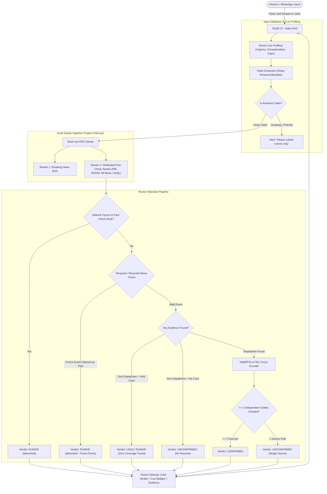

# CivicTrustHub 🛡️

> **Fast, Real-Time Rumor Detection & Fact Corroboration Pipeline**  
> Zero dummy data. Zero costly proprietary LLM APIs. Real-time dual-sweep news & fact-checking ingestion with DeBERTa-v3 NLI cross-attention inference.

[](LICENSE)
[](https://github.com/1SHAMAY1/CivicTrustHub)
[](https://1shamay1.github.io/CivicTrustHub/)

---

## 📌 Problem Statement
Unverified rumors, fabricated news, and coordinated disinformation proliferate across messaging apps (WhatsApp, Telegram) and social platforms (X, Instagram) within minutes. Forwarded messages often use psychological urgency cues ("URGENT forward to all groups", "Doctors secretly warned", "100% true shocking news") to induce panic.

Standard search engines and retrieval tools fail because:
1. **They treat search as retrieval rather than rumor detection**: Keyword search blindly matches words, ranking false rumors as top hits simply because they are trending.
2. **Forwarding noise pollutes search queries**: Passing raw forwarded text with emotional calls-to-action destroys search relevance.
3. **They lack dedicated fact-check sweep**: They do not query recognized independent fact-checking desks (PIB Fact Check, BOOM Live, Alt News, Factly).
4. **Single-source overconfidence**: A single uncorroborated blog post can falsely confirm a trending hoax.

---

## 💡 Solution
**CivicTrustHub** is an automated, zero-closed-API rumor detection pipeline specifically engineered to identify, decompose, and verify suspicious online claims and forwarded messages in under 2 seconds:
- **Claim Extraction**: Strips forwarding boilerplate ("URGENT", "forward to all", "share with everyone") to isolate the core factual assertion.
- **Rumor Cue Profiling**: Evaluates emotional and manipulative markers (forward urgency, sensationalism, vague authority appeals, excessive capitalization).
- **Dual-Stream Verification**: Simultaneously executes a breaking news sweep and a dedicated fact-checker sweep across accredited organizations (`PIB Fact Check`, `BOOM`, `Alt News`, `Factly`, `Newschecker`, `Vishvas News`).
- **Multi-Source Corroboration Rule**: Strictly requires $\ge 2$ independent outlets before any claim is labeled `CONFIRMED`.
- **Absence-of-Evidence Signal**: Silence from credible media regarding high-profile catastrophe or casualty claims is categorized as `LIKELY RUMOR`.
- **Temporal & Recycled News Guard**: Identifies recycled archival videos and future event announcements masquerading as past occurrences.

---

## 🛡️ Honest Rumor Verdict Model
CivicTrustHub implements a strict, fact-centered 5-state verdict architecture:

| Verdict | Status Color | Meaning | Condition |
| :--- | :--- | :--- | :--- |
| **RUMOR (debunked)** | 🔴 Red | Debunked Hoax | Refuted by recognized fact-checking desks or contradicted by official reports. |
| **LIKELY RUMOR** | 🟠 Orange-Red | Unsubstantiated Forward | Contains viral forward cues or high-profile assertions with zero corroborating media coverage. |
| **UNCONFIRMED** | 🟡 Amber | Inconclusive Evidence | Reported by only 1 outlet (awaiting secondary corroboration) or neutral dispatches. |
| **CONFIRMED** | 🟢 Green | Verified Real Event | Entailment verified across $\ge 2$ independent, accredited news organizations via DeBERTa NLI cross-encoder ($P \ge 0.60$). |
| **UNAVAILABLE / INVALID** | ⚪ Slate | Non-Claim / Network Drop | Conversational chitchat, greetings, or connection timeouts explicitly reported without fake metrics. |

---

## 🏗️ Architecture & Verification Flow



---

## ⚙️ Technology Stack

| Component | Technologies Used | Purpose |
| :--- | :--- | :--- |
| **NLI Cross-Encoder** | **DeBERTa-v3 NLI** (`cross-encoder/nli-deberta-v3-base`) | 500MB cross-attention inference model for semantic entailment and contradiction scoring. |
| **Vector Fallback** | **MiniLM SentenceTransformer** (`all-MiniLM-L6-v2`) | Lightweight PyTorch tensor vector fallback if cross-encoder weights are offline. |
| **Backend API** | **FastAPI + Uvicorn** | High-performance asynchronous REST verification backend with startup preloading. |
| **Ingestion Engine** | **Dual Google News RSS + Fact-Check Sweep** | Real-time live XML parser for breaking news and accredited fact-checking repositories. |
| **Frontend UI** | **HTML5 + TailwindCSS (Skeuomorphic Design)** | Clean, lightweight interface with live rumor cue tags, source badges, and regional Hindi alerts. |

---

## 🧪 Evaluation & Testing

Run unit tests directly via standard Python (UTF-8 enabled):
```bash
python -X utf8 -c "import test_core; [getattr(test_core, f)() for f in dir(test_core) if f.startswith('test_')]; print('ALL TESTS PASSED')"
```

All core unit tests verify:
1. `test_detect_forward_urgency_cues`: Detects forwarding triggers (`URGENT!!`, `Forward to all`).
2. `test_detect_sensational_and_vague_authority`: Identifies emotional hyperbole and uncited expert claims.
3. `test_extract_rumor_claim_from_boilerplate`: Correctly isolates the core assertion from WhatsApp forwarding headers.
4. `test_hindi_script_preserved` & `test_bengali_script_preserved`: Verifies zero data loss for Indic vowel signs and combining marks.
5. `test_fact_check_desk_match_flags_rumor_debunked`: Verifies matching against recognized fact-checkers (`BOOM`, `PIB Fact Check`).
6. `test_absence_of_coverage_on_viral_forward_flags_likely_rumor`: Flags viral rumors lacking mainstream reporting.
7. `test_multi_source_required_for_confirmed`: Ensures single-source reports cannot falsely return `CONFIRMED`.

---

## 👥 Authors & Contributors
- **Shankharaj Datta** – System Architect & Verification Pipeline Design
- **Soumendu Das** – Backend Engineer & Model Integration
- **Ankan Laskar** – Frontend Engineer & UI/UX Design

Licensed under the [MIT License](LICENSE). 100% Free and Open Source Software (FOSS).
